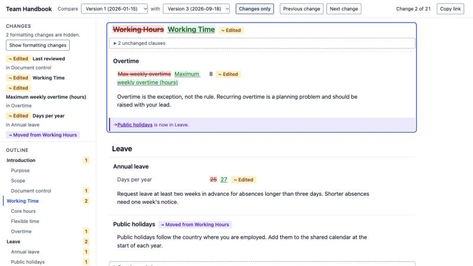

# handbook-diff-viewer

A small Vue 3 app. A reader opens a structured document and sees what changed between two versions.

The task is in [`docs/BRIEF.md`](docs/BRIEF.md). The data in [`data/`](data/) is as delivered.



## Run

You need Node 22.18 or later.

```bash
npm install
npm run dev
```

Other commands:

```bash
npm run gate   # type check, lint, format check, unit tests, build, prose lint
npm test       # unit tests only
```

Please keep `package-lock.json`. npm 10 cannot resolve this dependency tree from `package.json` alone and stops with an internal error. With the lock file it installs.

## What it does

- You pick two versions. The app opens on the previous version against the latest, and the base version is always the older one.
- You read one document: the target version in reading order, with each change marked where it is.
- A change is added, removed, edited, moved or reordered. Each mark has a glyph and a word next to its colour.
- An edited paragraph marks only the words that differ.
- The side panel lists all changes, and "Previous change" and "Next change" step through them.
- "Changes only" folds each run of unchanged content. Find-in-page still reaches the folded text.
- The address holds the two versions, the switches and the selected change. "Copy link" copies it.

The app has a light and a dark theme and follows the setting of the system.

## The reader

The brief leaves the reader open. I chose this one:

> A team member who read an older version some months ago and asks:
> "What changed since then, and does it change what I do?"

This reader does not edit the document. After the review, the reader shares a link to one change or closes the app.

## Questions and assumptions

The brief allows questions or written assumptions, and I took the second path. These are the questions I would ask, each with the assumption that the app takes.

| # | Question | Assumption |
|---|---|---|
| 1 | Who is the reader? | A team member who knows an older version |
| 2 | What does the reader do after the review? | Share one change. A confirmation step comes next |
| 3 | Is each version a full snapshot? | Yes, as in the mock data |
| 4 | Can a node keep its meaning and get a new id? | Yes. The app must not claim more than "likely" |
| 5 | Does a change of whitespace or number format matter to a reader? | No, but the reader can inspect each one |
| 6 | What does the status `draft` mean? | The clause is not yet in force |
| 7 | Is the inline markup trusted? | No |
| 8 | Is the format of a date part of the content? | Yes. The app does not change it |

## What the data holds

The first step, before any code, was to compare the three files. Each row below tests one point that the brief leaves open.

| Node | What happens | Tests |
|---|---|---|
| `p-leave-sick-1`, v1 to v2 | Only whitespace changes | Noise |
| `f-exp-equipment-limit`, v1 to v2 | `1,000 EUR` becomes `1000 EUR` | Noise |
| `f-intro-reviewed`, v1 to v2 | `2026-01-15` becomes `02.04.2026` | A real edit in a new format |
| `cl-hours-holidays`, v1 to v2 | Moves to another section, content equal | Moved |
| `sec-comms`, v1 to v2 | Two clauses swap places | Reordered |
| `cl-sec-passwords` to `cl-sec-credentials`, v1 to v2 | New id and title, same place, one word differs | Renamed under a new id |
| `cl-tool-trello` to `cl-tool-cursor`, v1 to v2 | A real removal and a real addition | Must not look like a rename |
| `f-hours-overtime-max`, v1 to v2 | The label changes, the value does not | Renamed label |
| `sec-hours`, v2 to v3 | The title changes | Renamed section |
| `p-exp-reimbursement-1`, v2 to v3 | Gains a link and an `img` with an `onerror` handler | Unsafe markup |
| `cl-remote-coworking`, v3 | A new clause with the status `draft` | Status |
| `f-sec-access-cadence`, v2 to v3 | The field is removed | Removed leaf |
| `sec-tools` | 40 clauses, and 5 status edits over two versions | Scale |
| `sec-remote`, v2 | A new section with 3 clauses | Added subtree |

[`docs/SPEC.md`](docs/SPEC.md) lists the expected changes for each comparison by node id. The tests take their expected values from that list.

## Decisions

[`docs/DECISIONS.md`](docs/DECISIONS.md) has the context of each decision and what was rejected.

| | Decision | Reason |
|---|---|---|
| D1 | One document view, not two columns | A reader reads one document. Two columns halve a laptop screen |
| D2 | Any older version against any newer one | "Since I last read it" needs version 1 against version 3 |
| D3 | Nodes match by id, and a move is one change | The schema says ids are stable |
| D4 | A reorder marks the fewest nodes | One inserted node must not mark all nodes after it |
| D5 | Formatting changes are hidden, counted and open to inspection | A tool that hides things and does not say so loses trust |
| D6 | A likely rename is labelled as a guess | The schema says a new id is a new node |
| D7 | Inline markup becomes tokens, never HTML | Version 3 holds markup that tries to run code |
| D8 | The only runtime dependency is Vue | The brief asks for a reason for each dependency |
| D9 | Only features that are Baseline Widely available | The reviewer can use any current desktop browser |
| D10 | Unchanged content folds and stays in the page | Find-in-page must reach it |
| D11 | No attribution lines in commits | This README says how AI was used |
| D12 | Outside guidance is distilled, not installed | Most of each skill set is for other kinds of work |
| D13 | TypeScript 6, not 7 | `typescript-eslint` does not support 7 yet |

## Dependencies

### Runtime

| Package | Why |
|---|---|
| `vue` | The framework that the brief asks for. It is the only runtime dependency (D8) |

The app has no store, no router, no UI kit, no CSS framework and no comparison library. One function for the longest common subsequence, 31 lines of code, does the word comparison and the reorder rule. I considered `@vueuse/core`, and the check for each need is in [`docs/conventions/vue.md`](docs/conventions/vue.md).

### Development

| Package | Why |
|---|---|
| `vite` | Dev server and build. The brief asks for it |
| `@vitejs/plugin-vue` | Lets Vite compile `.vue` files |
| `typescript` | The brief prefers it. Version 6.0 (D13) |
| `vue-tsc` | Type check for `.vue` files, which `tsc` cannot read |
| `@vue/tsconfig` | The base config of the Vue team, with strict checks |
| `@tsconfig/node24` | The base config for the config files that run in Node |
| `@types/node` | Types for Node in config files and tests |
| `vitest` | Unit tests with the same config as the build |
| `@vue/test-utils` | Mounts the app in a test |
| `jsdom` | A DOM for tests. The markup parser needs `DOMParser` |
| `@types/jsdom` | Types for the test environment |
| `eslint` | Lint. Two of its rules guard decisions D7 and D8 |
| `eslint-plugin-vue` | The Vue rules, with `vue/no-v-html` as an error |
| `vue-eslint-parser` | Reads `.vue` files for ESLint |
| `@vue/eslint-config-typescript` | The TypeScript rules for `.vue` and `.ts` files |
| `eslint-config-prettier` | Turns off lint rules that fight the formatter |
| `jiti` | Lets ESLint load its config, which is TypeScript |
| `prettier` | Formats the code in one style |

`create-vue` made the project. Its template has five packages that this project does not need, so they are not here:

- oxlint and its ESLint plugin
- the Vue devtools plugin
- `npm-run-all2`
- the Vitest ESLint plugin

## How I worked with an agent

I used Claude Code for the plan, the code and the reviews.

### Before any code

The first commits on `main` have no app code. They hold what the agent works from:

- [`docs/SPEC.md`](docs/SPEC.md): the reader, the change kinds, the data findings and the expected changes by node id.
- [`docs/DECISIONS.md`](docs/DECISIONS.md): the decisions above. The agent proposes options, and a product decision is mine.
- [`docs/cards/`](docs/cards/): the build, cut into cards. Each card has a scope, a list of what is out of scope, and acceptance criteria that each name a test or a check.
- [`CLAUDE.md`](CLAUDE.md): the rules for each change, each with its reason.

### Rules from outside sources

Five public skill sets have rules that fit this app. I did not install them (D12). Each one became a short convention file and a thin skill that points to it:

| Area | File |
|---|---|
| Writing | [`docs/conventions/writing.md`](docs/conventions/writing.md) |
| HTML, CSS and browser features | [`docs/conventions/web-platform.md`](docs/conventions/web-platform.md) |
| Layout, colour and accessibility | [`docs/conventions/ui.md`](docs/conventions/ui.md) |
| Vue | [`docs/conventions/vue.md`](docs/conventions/vue.md) |
| Tests | [`docs/conventions/testing.md`](docs/conventions/testing.md) |

[`.claude/skills/README.md`](.claude/skills/README.md) links each source at the commit that was read, and says what was kept and what was dropped.

### One card, one branch, one pull request

Each card went through the same steps:

1. A branch from `develop`.
2. For the engine and the markup parser: a failing test first, in its own commit, then the code.
3. `npm run gate`. CI runs the same script.
4. A check in a real browser for each UI card: light theme, dark theme, and the numbers from `docs/SPEC.md`.
5. A review by a read-only agent, [`.claude/agents/code-reviewer.md`](.claude/agents/code-reviewer.md). It reports only findings that it is sure of, each with the rule that is broken.
6. A pull request with the acceptance table, the gate result and the review.

The pull requests #1 to #6 have the record of each card.

### Guardrails

A rule that is only written down can be forgotten. The gate checks these five rules, so a change that breaks one of them does not pass.

- **No raw HTML from the data.** In Vue, `v-html` puts a string into the page as HTML, and the `img` with a handler in version 3 would then run. The lint rule `vue/no-v-html` is an error (D7).
- **The engine has no framework.** A file in `src/domain/` that imports Vue fails the lint step (D8). The engine stays plain TypeScript, so a test can run it with no page.
- **Lint at once.** A hook lints each file right after the agent saves it. The agent sees the finding in the same turn and fixes it there.
- **Contrast.** A test reads the colour file and computes the contrast of each text and background pair, in the light and the dark theme. A colour that is too weak fails the test.
- **Plain English.** A linter reads the Markdown files, the cards and the skills. A sentence of more than 25 words, a semicolon or a sales word fails the gate.

### What went wrong and what caught it

The agent made mistakes during the build. This table lists them, each with what caught it.

| What went wrong | What caught it |
|---|---|
| Under 900 pixels, the page jumped to the top when the section in view changed | The reviewer |
| A clause that moved into a new section was lost: no change, no edit | The reviewer, with a small test document |
| The contrast test checked nothing: the test runner gave an empty string for the CSS file | A check in the same test that the file was read |
| The summary read "12 changes2 formatting changes" | A mount test |
| A test expected a label that the agent had guessed. The data says something else | The test |
| A component computed the word comparison, against the project's own rule | The reviewer |
| A screen reader would read removed text as current text | The reviewer |
| "Changes only" folded the clauses of a new section as "3 unchanged clauses" | The reviewer. The browser check had covered only one of the three comparisons |
| Two tests built their expected values from the output of the code | The reviewer |
| Hidden text for screen readers made the page 318 pixels taller | The browser check |

One check has no automation. No script can start find-in-page, so I checked by hand that it opens a fold.

For the card with the unsafe markup, the reviewer acted as an attacker who controls the data. It tried about 60 inputs and found no path to code that runs. Three of them are unit tests now.

## Testing

| What | How |
|---|---|
| The diff engine, the markup parser, the fold rule, the address | Unit tests, test first for the engine and the parser |
| The app as a whole | Mount tests: versions, counts, marks, folds, navigation, address, copy |
| Colour contrast | A unit test that reads the token file |
| Layout, focus, scrolling, themes | A check in a real browser for each card, recorded in the card |
| Find-in-page | By hand |

There are 152 unit tests. A test guards an acceptance criterion, an invariant or a bug that really happened, and its expected value comes from the data or from `docs/SPEC.md`.

## Not done and what I would do next

### Decided, not built

- Rename under a new id (D6). `cl-sec-passwords` and `cl-sec-credentials` show as one removed and one added clause, next to each other. Card 007 pairs them as "Replaced, likely renamed".
- A browser test. Card 008 adds one Playwright test for the main path. Today the browser checks are done by hand.

### Not measured

- A screen reader. The `<del>`, `<ins>` and hidden words are checked in the DOM only.
- Find-in-page in a second browser engine.
- A window under 900 pixels with all controls. The brief asks for a laptop screen.
- A large document. See the next section.

### If the document grows

The mock data has 3 versions and about 190 nodes. The handbook itself says that it is reviewed every 6 months.
If that holds, three years give six versions or more, and a real handbook is much larger.
I did not test this size. These are the places where the app would break first, and what I would do.

| Today | With many large versions | What I would do |
|---|---|---|
| The app loads all versions at the start | The start gets slow | Load only the two versions in the comparison |
| Two lists to pick the versions | "Which one did I read?" gets hard to answer | Remember the last version that the reader saw, and compare from there |
| A comparison of two versions | No answer to "when did this clause change?" | A history of one node over all versions |
| The whole document is in the page | Scrolling gets heavy with thousands of nodes | Render a section only when it comes near the screen |
| The browser computes the comparison at each visit | A delay on a large document | Compute it once when a version is published, and store the result |
| The word comparison uses a table of one text times the other | Slow for a very long paragraph | A limit on the length, or a faster algorithm |
| One flat list of changes | 300 changes are not readable as one list | Group by section and by kind, with a filter |

### Next, in this order

1. A confirmation step: the reader marks a change as read, and the next visit shows only what is new.
2. Usage data: which changes readers open and which they skip. It shows if the order and the noise rule are right.
3. Dates in one format for display, with the original value kept.
4. A layout for a phone.
5. A way back to the top bar from a change, for keyboard readers. Today that takes Shift and Tab.
